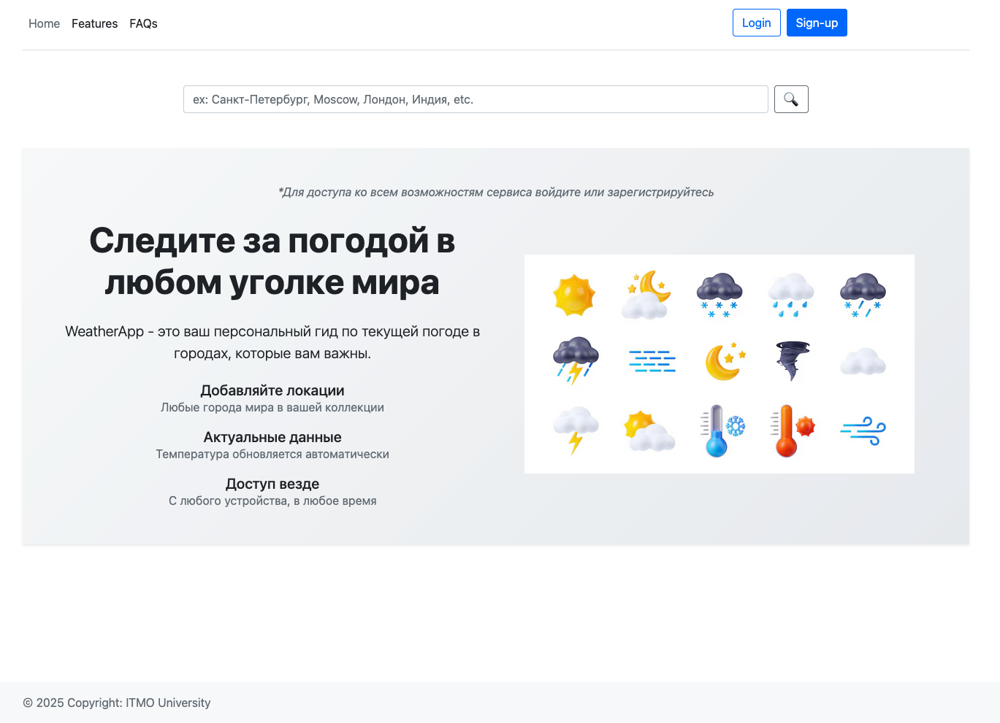
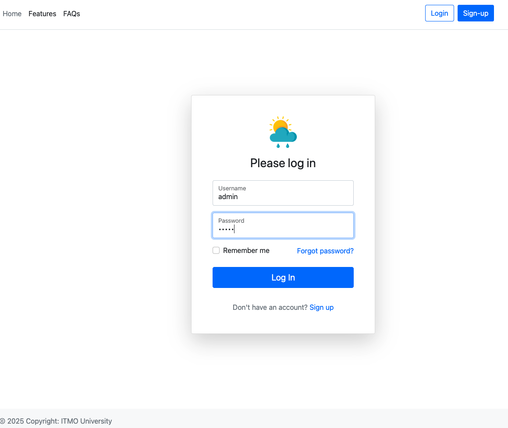
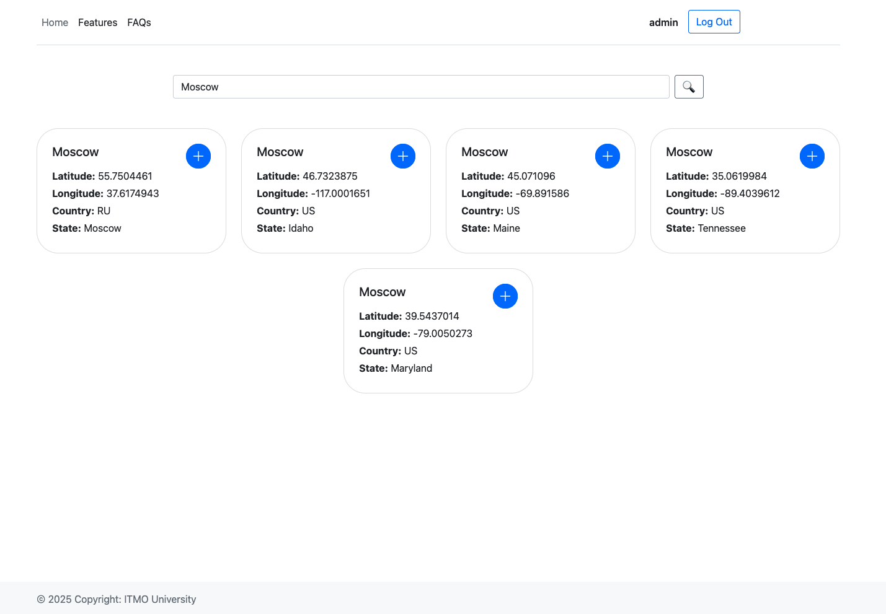
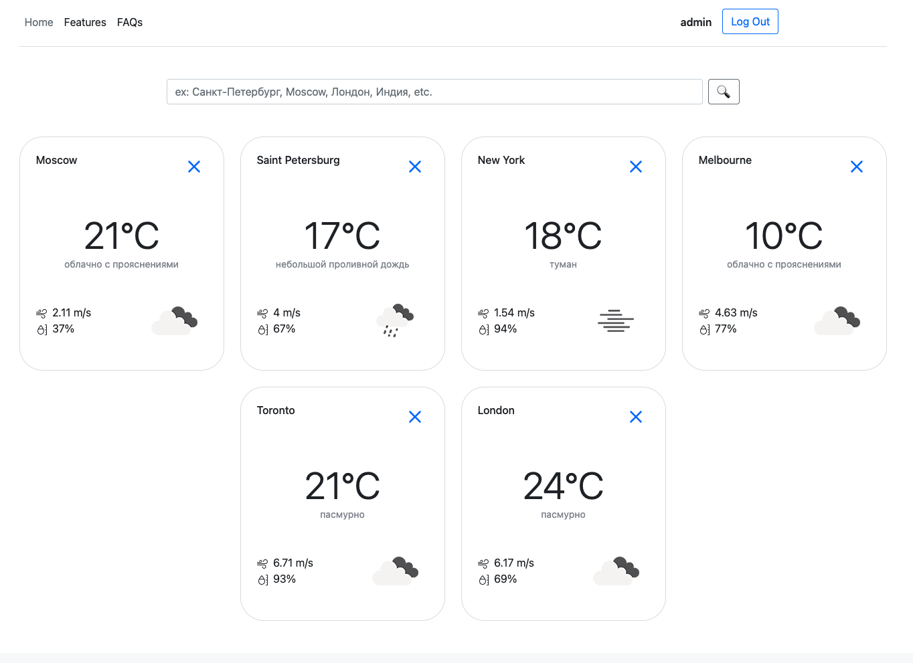

## Проект “Погода”

Веб-приложение для просмотра текущей погоды. Пользователь может зарегистрироваться и добавить в коллекцию одну или несколько локаций (городов, сёл, других пунктов), после чего главная страница приложения начинает отображать список локаций с их текущей погодой.

- Python - коллекции, ООП
- Паттерн MVC(S)
- pip/Poetry
- Backend
    - Django
- Базы данных
    - Postgres
    - DjangoORM
    - Миграции
- Frontend - HTML/CSS, Bootstrap
- Тесты - интеграционное тестирование, моки
- Деплой - облачный хостинг, командная строка Linux

## Мотивация проекта

- Реализация многопользовательского приложения
- Работа с внешними API

## Функционал приложения

Работа с пользователями:

- Регистрация
– Авторизация
– Logout

Работа с локациями:

- Поиск
- Добавление в список
- Просмотр списка локаций, для каждой локации отображается название и температура
- Удаление из списка

## Запуск приложения

```bash
python3 weather_app/manage.py runserver
```

## Интерфейс приложения








